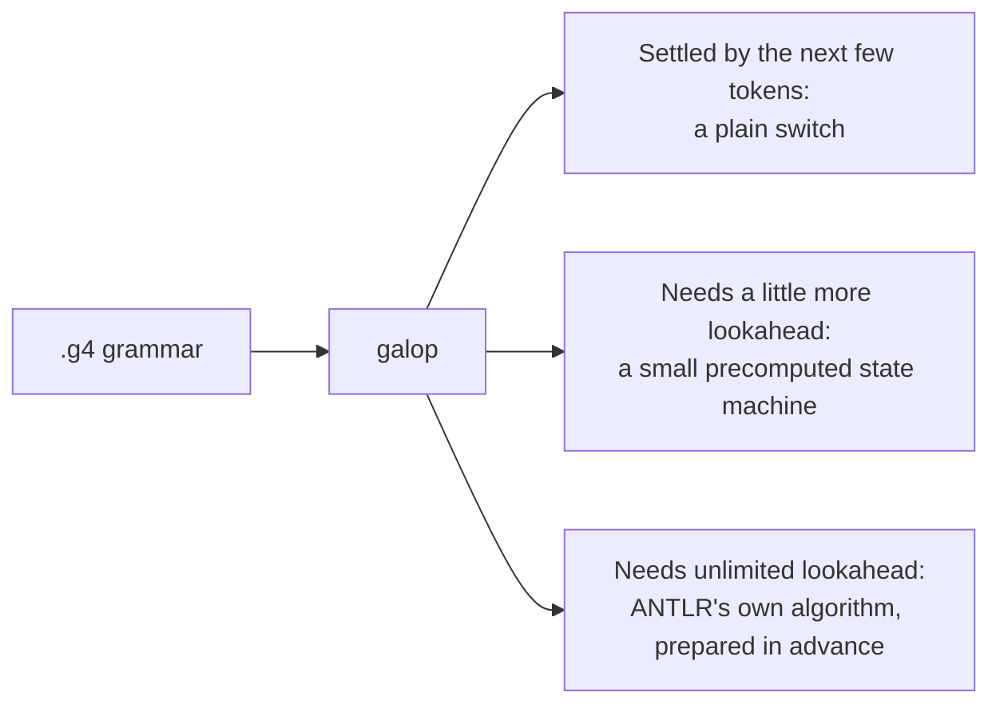

# galop

**galop** is a parser generator for ANTLR-style `.g4` grammars, written in
[GALA](https://github.com/martianoff/gala).

It reads the grammar you already have and works out parsing decisions when it
generates the parser, not while the parser runs. The output is plain
recursive-descent code with a `switch` on the next tokens wherever a few tokens of
lookahead decide. Only decisions that need unbounded lookahead run ANTLR's
prediction algorithm, over tables compiled into the generated file, so the parser
picks exactly what ANTLR would pick. It needs no grammar file at runtime and no
deserialization.

> **Status: early development.** galop generates a Go lexer and parser for the
> GALA compiler's grammar that produce exactly ANTLR's tokens and trees on the
> whole GALA source corpus (722 of 722 files ANTLR accepts) and on code it was
> not tuned on, in two flavors: its own compact tree (the default, 12× to 140×
> faster than ANTLR) or ANTLR's tree types (3× to 30×).
> Other grammars work as far as their features are supported (see below); see the
> [roadmap](docs/ROADMAP.md).

Time to lex and parse a whole corpus, against ANTLR driven the way the GALA
compiler drives it (SLL, with an LL retry on a syntax error). "Warm" is a repeat
pass in a long-running process; "fresh process" is the first pass after start-up,
which is what a compiler run pays. From `bazel run -c opt //differential/cmd/bench`,
Go 1.25 on Windows, one machine with 32 hardware threads:

| | ANTLR 4.13.1 | galop, `native` (default) | galop, `antlr` flavor |
|---|---:|---:|---:|
| **GALA compiler** (723 files, 1.8 MB) | | | |
| Warm, one goroutine | 797 ms | 64 ms (12×) | 242 ms (3.3×) |
| Warm, 32 goroutines | 436 ms | 11 ms (41×) | 52 ms (8.5×) |
| Fresh process, one goroutine | 1.47 s | 75 ms (20×) | 190 ms (7.7×) |
| Fresh process, 32 goroutines | 766 ms | 44 ms (18×) | 72 ms (11×) |
| Allocations per warm pass | 6.8 M, 526 MB | 19 k, 73 MB | 3.7 M, 298 MB |
| **Code galop was not tuned on** (gala_team, gala_tui, gala-server: 247 files, 3.6 MB) | | | |
| Warm, one goroutine | 5.18 s | 96 ms (54×) | 363 ms (14×) |
| Warm, 32 goroutines | 2.89 s | 21 ms (141×) | 95 ms (30×) |
| Fresh process, one goroutine | 6.58 s | 181 ms (36×) | 357 ms (18×) |
| Fresh process, 32 goroutines | 2.82 s | 140 ms (20×) | 194 ms (15×) |

The `native` flavor is the default; the `antlr` flavor is for programs already
written against ANTLR's trees, and spends most of its time building ANTLR's
token and tree objects. Most of ANTLR's time on the second corpus goes to two
large files where its fast pass fails and it parses the whole file again in its
slow mode; galop fixes such a pass in place (see [design](docs/DESIGN.md#runtime-prediction)).

On more than 60,000 broken files from both corpora, galop's first syntax error
matches the message, line and column ANTLR reports when it starts with an empty
prediction cache. ANTLR's own `~set` bug is the one known exception (see [design](docs/DESIGN.md#reporting-syntax-errors-as-antlr-does)).

## Why

A parser keeps choosing which grammar alternative comes next. ANTLR makes those
choices while it parses: it works them out from the grammar at runtime and
learns as it goes, starting from scratch in every new process. That warm-up is
most of the parse for a short-lived tool like a compiler.

galop makes those choices when it generates the parser, and picks the cheapest
form for each:



In the GALA grammar, 86 of 107 choices land in the first group, so most of the
parser is the kind of code you would write by hand. The rare hard cases still
run ANTLR's algorithm, so the parser always picks exactly what ANTLR would. That
part runs faster than ANTLR's too: it steps over a bracketed group like `( … )` in one go
rather than reading every token inside, and when a guess turns out wrong it
fixes that one choice instead of parsing the whole file again. The lexer is
built entirely ahead of time.

What you keep:

- **Your grammar.** galop reads the same `.g4` file. No rewrite.
- **The same results.** Tokens and trees match ANTLR's on the whole GALA corpus,
  in both flavors.
- **Your code, if you want.** The `antlr` flavor builds ANTLR's own parse-tree
  types, so existing listeners and visitors keep working. The default, `native`,
  builds galop's own compact tree, with ANTLR's accessors (`ctx.Expression()`,
  `ctx.AllStatement()`, `ctx.IDENTIFIER()`, `ctx.GetGuard()`), so porting code
  written against ANTLR's trees is mostly renaming; it has no dependency.

What you get: a faster parser, especially when many goroutines parse at once
(see the table above). galop's first user is the GALA compiler itself.

## Install

Build from source with the [GALA CLI](https://github.com/martianoff/gala/releases):

```sh
git clone https://github.com/martianoff/galop
cd galop
gala build -o galop ./cmd/galop
```

Tagged releases publish binaries for Linux, macOS and Windows.

## Usage

galop is used like ANTLR's `antlr4` tool: the same options, the same output
layout, the same message format.

```sh
galop -o gen -package parser Expr.g4      # generate Go code into gen/
galop -depend -o gen Expr.g4              # list the files it would write
galop -check -roundtrip grammars/*.g4     # validate only; also check the formatter keeps each grammar
galop -format Expr.g4                     # print the grammar in canonical form
galop -report Expr.g4                     # list the decisions static lookahead cannot settle
```

```
galop 0.0.0-dev, a parser generator for ANTLR 4 grammars
usage: galop [options] grammar.g4...
 -o ___              specify output directory where all output is generated
 -lib ___            specify location of grammars, tokens files
 -atn                generate rule augmented transition network diagrams
 -message-format ___ specify output style for messages in antlr, gnu, vs2005
 -listener           generate parse tree listener (default)
 -no-listener        don't generate parse tree listener
 -visitor            generate parse tree visitor
 -no-visitor         don't generate parse tree visitor (default)
 -package ___        specify a package/namespace for the generated code
 -depend             generate file dependencies
 -D<option>=value    set/override a grammar-level option
 -Werror             treat warnings as errors
 -Xexact-output-dir  all output goes into -o dir regardless of paths/package
galop options:
 -check              validate grammars without generating anything
 -roundtrip          with -check, also verify that formatting keeps each grammar
 -format             print each grammar in canonical form
 -report             print the decisions static lookahead cannot settle
 -Xno-brackets       predict over tokens only, never reading a bracketed group as one
 -version            print the galop version
 -help               print this help
```

- **Targets.** `-Dlanguage=Go` (the default) picks the Go target, and
  `-Dflavor=native|antlr` its output style, `native` by default (see
  [design](docs/DESIGN.md#code-generation-codegen-golang)). `-D` options override
  the grammar's own `options {}`; an unknown flavor is error 508.
- **Output layout** follows ANTLR: files go next to the grammar; with `-o dir`
  they go to `dir` plus the grammar's relative directory (`-o gen sub/T.g4`
  writes to `gen/sub/`), unless `-Xexact-output-dir` is given.
- **`-atn`** writes each rule's network as a Graphviz file, `T.rule.dot` (a
  combined grammar's lexer rules are `TLexer.RULE.dot`), as ANTLR does.
- **Messages** use ANTLR's numbers and wording where the problem is the same
  one ANTLR reports, and numbers from 500 up for galop's own (such as a
  construct it does not support yet). `-message-format` picks ANTLR's layouts:

  ```
  error(56): Expr.g4:4:33: reference to undefined rule: factor                  # antlr (default)
  grammars/Expr.g4:4:33: error: reference to undefined rule: factor [error 56]  # gnu
  grammars/Expr.g4(4,33) : error 56 : reference to undefined rule: factor       # vs2005
  ```

  As in ANTLR, the column is the 0-based character position, and the `antlr`
  layout shows only the file name. The exit code is 1 when any error was
  reported; `-Werror` makes warnings errors.
- **`-check`** parses, checks and compiles each grammar: syntax errors,
  undefined or redefined rules, lexer rules that reference parser rules,
  parser rules that reference fragments, undecodable literals and sets, and
  (a warning, as in ANTLR) tokens used but never defined.
- **`-format`** prints a canonical form. Comments are not part of the grammar
  model, so they are not printed.

`-lib` is accepted; importing grammars or a token vocabulary (`import`,
`tokenVocab`) is not supported yet and is reported as an error.

Grammar files are processed concurrently and independently: an error in one
does not stop the others, and output is reported in command-line order.

### Flavors

The Go target writes one of two kinds of parser, picked with `-Dflavor`:

| | `native` (default) | `antlr` |
|---|---|---|
| Files | `expr_lexer.go`, `expr_parser.go` | `expr_galop_lexer.go`, `expr_galop_parser.go` |
| Dependencies | none | ANTLR's Go runtime, and ANTLR's generated code in the same package |
| Tokens | a slice of 20-byte tokens; comments and other off-channel tokens in a side slice | `antlr.CommonToken`s from an `antlr.TokenStream` |
| Tree | galop's compact tree, with typed accessors per rule | ANTLR's own context types |
| For | new code, and speed | programs already written against ANTLR's trees |

With the `native` flavor, for `Expr.g4` in package `parser`:

```go
toks := parser.ExprLex(src)          // tokens; toks.Hidden holds the comments
prog, err := parser.ParseProg(toks)  // a *parser.ExprSyntaxError with line and column
for _, st := range prog.AllStat() {  // ANTLR's accessors, on typed handles
	if a, ok := st.AsAssign(); ok {  // a labeled alternative
		fmt.Println(a.ID().GetText(), a.Start().Line, a.Expr().GetText())
	}
}
```

Both flavors decide exactly as ANTLR does and give the same tokens and trees.
On input with a syntax error, both report the error ANTLR reports first, with
the same message, line and column. Neither recovers from syntax errors yet: a
parse stops at that first error.

### Bazel

[rules_gala](https://github.com/martianoff/rules-gala) provides
`galop_parser`, which runs galop on a `.g4` file and yields the generated Go
sources for a `go_library`.

## Supported `.g4` syntax

- `grammar`, `lexer grammar`, `parser grammar` headers
- `options { ... }`, `tokens { ... }`, `channels { ... }`, `@name { ... }` and `@scope::name { ... }` actions
- parser and lexer rules, `fragment` rules, alternatives with `# Label`
- rule and token references, quoted literals, `'a'..'z'` ranges, `[...]` sets, `.`, `~`
- `?` `*` `+` and their non-greedy forms `??` `*?` `+?`
- element labels `x=e` and `xs+=e`
- embedded actions `{...}` and predicates `{...}?`
- lexer commands: `-> skip`, `-> channel(HIDDEN)`, `-> pushMode(X)`, ...

Not supported yet, and reported as errors rather than ignored: rule arguments,
`returns`/`locals`, rule-level options and actions, element options
(`<assoc=right>`), lexer modes, grammar imports, the `tokenVocab` and
`caseInsensitive` options, and in the Go target, directly left-recursive rules
(`e : e '+' e | INT`, which ANTLR rewrites into a loop) and semantic
predicates. Mutually left-recursive rules are an error, as in ANTLR (error 119);
`-check` does not report ANTLR's errors for left recursion its rewrite cannot
handle (148, 169); the Go target rejects those rules as left-recursive.

## Development

See [AGENTS.md](AGENTS.md) for the project rules and [CONTRIBUTING.md](CONTRIBUTING.md)
for the workflow.

```sh
gala test                                        # unit tests
gala build -o galop ./cmd/galop                  # the CLI
./galop -check -roundtrip testdata/grammars/*.g4 # the grammar corpus
bazel test //...                                 # the same suite under Bazel
```

## License

[Apache 2.0](LICENSE)
