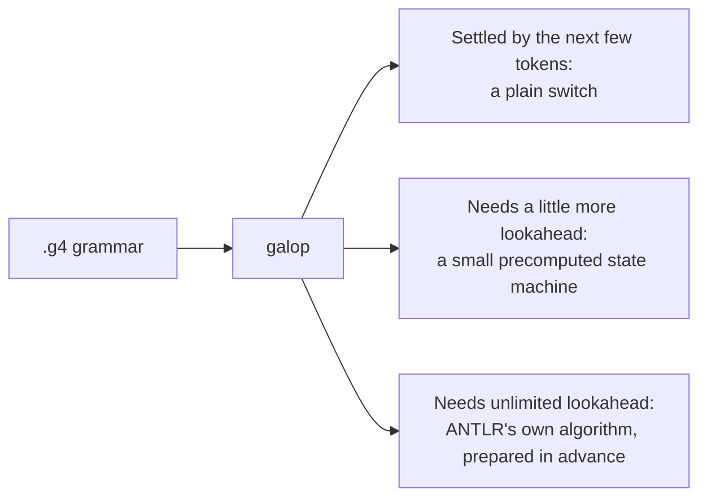

# galop

**galop** is a parser generator for ANTLR-style `.g4` grammars, written in
[GALA](https://github.com/martianoff/gala).

It reads the grammar you already have and works out parsing decisions when it
generates the parser, not while the parser runs. The output is plain
recursive-descent code with a `switch` on the next tokens wherever a few tokens of
lookahead decide. Only decisions that need unbounded lookahead run ANTLR's
prediction algorithm, over tables compiled into the generated file, so the parser
picks exactly what ANTLR would pick. It needs no grammar file at runtime and no
deserialization.

> **Status: early development.** galop generates a Go lexer and parser for the
> GALA compiler's grammar that produce exactly ANTLR's tokens and trees on the
> whole GALA source corpus (722 of 722 files ANTLR accepts), several times faster.
> Other grammars work as far as their features are supported (see below); see the
> [roadmap](docs/ROADMAP.md).

On the GALA corpus (723 files, 1.8 MB; Go 1.25, one machine; ANTLR driven the way
the GALA compiler drives it, SLL with an LL retry):

| | ANTLR 4.13.1 | galop | |
|---|---:|---:|---:|
| First pass in a fresh process | 2.00 s | 0.72 s | 2.8× |
| Warm, one goroutine | 0.58 s | 0.19 s | 3× |
| Warm, 32 goroutines | 394 ms | 67 ms | 5.9× |
| Lexer only, warm, parallel | 107 ms | 11 ms | 10× |

## Why

A parser keeps choosing which grammar alternative comes next. ANTLR makes those
choices while it parses: it works them out from the grammar at runtime and
learns as it goes, starting from scratch in every new process. That warm-up is
most of the parse for a short-lived tool like a compiler.

galop makes those choices when it generates the parser, and picks the cheapest
form for each:



In the GALA grammar, 86 of 107 choices land in the first group, so most of the
parser is the kind of code you would write by hand. The rare hard cases still
run ANTLR's algorithm, so the parser always picks exactly what ANTLR would. The
lexer is built entirely ahead of time.

What you keep:

- **Your grammar.** galop reads the same `.g4` file. No rewrite.
- **Your code.** The parser builds ANTLR's own parse-tree types, so existing
  listeners and visitors keep working.
- **The same results.** Tokens and trees match ANTLR's on the whole GALA corpus.

What you get: a faster parser, especially in a fresh process and when many
goroutines parse at once (see the table above). A hand-written parser for the
same grammar is still faster, about 10× ANTLR warm; closing that gap is the next
milestone. galop's first user is the GALA compiler itself.

## Install

Build from source with the [GALA CLI](https://github.com/martianoff/gala/releases):

```sh
git clone https://github.com/martianoff/galop
cd galop
gala build -o galop ./cmd/galop
```

Tagged releases publish binaries for Linux, macOS and Windows.

## Usage

galop is used like ANTLR's `antlr4` tool: the same options, the same output
layout, the same message format.

```sh
galop -o gen -package parser Expr.g4      # generate Go code into gen/
galop -depend -o gen Expr.g4              # list the files it would write
galop -check -roundtrip grammars/*.g4     # validate only; also check the formatter keeps each grammar
galop -format Expr.g4                     # print the grammar in canonical form
galop -report Expr.g4                     # list the decisions static lookahead cannot settle
```

```
galop 0.0.0-dev, a parser generator for ANTLR 4 grammars
usage: galop [options] grammar.g4...
 -o ___              specify output directory where all output is generated
 -lib ___            specify location of grammars, tokens files
 -atn                generate rule augmented transition network diagrams
 -message-format ___ specify output style for messages in antlr, gnu, vs2005
 -listener           generate parse tree listener (default)
 -no-listener        don't generate parse tree listener
 -visitor            generate parse tree visitor
 -no-visitor         don't generate parse tree visitor (default)
 -package ___        specify a package/namespace for the generated code
 -depend             generate file dependencies
 -D<option>=value    set/override a grammar-level option
 -Werror             treat warnings as errors
 -Xexact-output-dir  all output goes into -o dir regardless of paths/package
galop options:
 -check              validate grammars without generating anything
 -roundtrip          with -check, also verify that formatting keeps each grammar
 -format             print each grammar in canonical form
 -report             print the decisions static lookahead cannot settle
 -version            print the galop version
 -help               print this help
```

- **Targets.** `-Dlanguage=Go` (the default) picks the Go target, and
  `-Dflavor=companion|standalone` its output style (see
  [design](docs/DESIGN.md#code-generation-codegen-golang)). `-D` options override
  the grammar's own `options {}`.
- **Output layout** follows ANTLR: files go next to the grammar; with `-o dir`
  they go to `dir` plus the grammar's relative directory (`-o gen sub/T.g4`
  writes to `gen/sub/`), unless `-Xexact-output-dir` is given.
- **`-atn`** writes each rule's network as a Graphviz file, `T.rule.dot` (a
  combined grammar's lexer rules are `TLexer.RULE.dot`), as ANTLR does.
- **Messages** use ANTLR's numbers and wording where the problem is the same
  one ANTLR reports, and numbers from 500 up for galop's own (such as a
  construct it does not support yet). `-message-format` picks ANTLR's layouts:

  ```
  error(56): Expr.g4:4:33: reference to undefined rule: factor                  # antlr (default)
  grammars/Expr.g4:4:33: error: reference to undefined rule: factor [error 56]  # gnu
  grammars/Expr.g4(4,33) : error 56 : reference to undefined rule: factor       # vs2005
  ```

  As in ANTLR, the column is the 0-based character position, and the `antlr`
  layout shows only the file name. The exit code is 1 when any error was
  reported; `-Werror` makes warnings errors.
- **`-check`** parses, checks and compiles each grammar: syntax errors,
  undefined or redefined rules, lexer rules that reference parser rules,
  parser rules that reference fragments, undecodable literals and sets, and
  (a warning, as in ANTLR) tokens used but never defined.
- **`-format`** prints a canonical form. Comments are not part of the grammar
  model, so they are not printed.

`-lib` is accepted; importing grammars or a token vocabulary (`import`,
`tokenVocab`) is not supported yet and is reported as an error.

Grammar files are processed concurrently and independently: an error in one
does not stop the others, and output is reported in command-line order.

### Bazel

[rules_gala](https://github.com/martianoff/rules-gala) provides
`galop_parser`, which runs galop on a `.g4` file and yields the generated Go
sources for a `go_library`.

## Supported `.g4` syntax

- `grammar`, `lexer grammar`, `parser grammar` headers
- `options { ... }`, `tokens { ... }`, `channels { ... }`, `@name { ... }` and `@scope::name { ... }` actions
- parser and lexer rules, `fragment` rules, alternatives with `# Label`
- rule and token references, quoted literals, `'a'..'z'` ranges, `[...]` sets, `.`, `~`
- `?` `*` `+` and their non-greedy forms `??` `*?` `+?`
- element labels `x=e` and `xs+=e`
- embedded actions `{...}` and predicates `{...}?`
- lexer commands: `-> skip`, `-> channel(HIDDEN)`, `-> pushMode(X)`, ...

Not supported yet, and reported as errors rather than ignored: rule arguments,
`returns`/`locals`, rule-level options and actions, element options
(`<assoc=right>`), lexer modes, grammar imports, and the `tokenVocab` and
`caseInsensitive` options.

## Development

See [AGENTS.md](AGENTS.md) for the project rules and [CONTRIBUTING.md](CONTRIBUTING.md)
for the workflow.

```sh
gala test                                        # unit tests
gala build -o galop ./cmd/galop                  # the CLI
./galop -check -roundtrip testdata/grammars/*.g4 # the grammar corpus
bazel test //...                                 # the same suite under Bazel
```

## License

[Apache 2.0](LICENSE)
