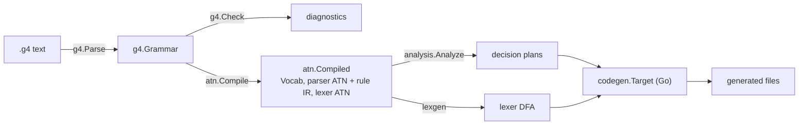

# galop design

This is the working design behind the [roadmap](ROADMAP.md): how a `.g4` grammar
becomes a parser, and the contracts between the packages that do it.

## Pipeline



| Package | Role |
|---|---|
| `g4` | `.g4` reader: lexer, parser, model, formatter, semantic checks |
| `atn` | Token numbering (ANTLR-compatible), the ATN, the parser rule IR |
| `analysis` | FIRST/FOLLOW, static LL(k) per decision, adaptive decisions, conflict report |
| `brackets` | Bracket pairs runtime prediction may read as one symbol (see [Bracket abstraction](#bracket-abstraction)) |
| `lexgen` | Lexer ATN → DFA with ANTLR's lexer semantics |
| `codegen` | The `Target` interface; `cmd/galop` lists the targets a binary ships |
| `golang` | The Go target |
| `diag` | Diagnostics: ANTLR's error numbers and message formats, galop's own codes |
| `tool` | The command line: argument parsing, output layout, the per-file pipeline |
| `cmd/galop` | `main`: wires the targets and the file system into `tool` |

Each stage is a pure function of the previous stage's output, so stages that do
not depend on each other run concurrently (see [Concurrency](#concurrency)).

## Compatibility with ANTLR

galop's contract is "the same grammar means the same thing as in ANTLR 4":

- **Token types** are numbered as ANTLR numbers them (`atn/vocab.gala`): implicit
  literal tokens `T__n` in order of first use in parser rules, then non-fragment
  lexer rules in file order, then `tokens {}` names, then names only referenced.
  Generated code can therefore consume tokens from an ANTLR-generated lexer and
  vice versa.
- **Decisions and alternative numbers** come from an ATN built the way ANTLR builds
  it (`atn/build.gala`): an optional block's alternatives and its exit share one
  decision; a loop has its own enter/exit (or repeat/exit) decision; a non-greedy
  quantifier puts the exit first; a block of single-token alternatives is a set, not
  a decision.
- **Prediction** picks the alternative ANTLR's prediction picks on every input ANTLR
  parses without a syntax error. Two mechanisms, chosen per decision by the analysis:
  1. *Static lookahead.* If the alternatives' lookahead languages (computed with
     global FOLLOW, i.e. any calling context) are disjoint within K ≤ 3 tokens, the
     decision is a `switch` on `LA(1)`, then `LA(2)`… Only one alternative can be
     viable on that lookahead in any context, so this agrees with ANTLR.
  2. *Adaptive prediction*, for the decisions static lookahead cannot settle. This is
     ANTLR's own prediction (its Go runtime 4.13.1, quirks included) run over the
     ATN, which generated parsers carry as Go literal tables:
     - **SLL first.** The calling context is a wildcard: a rule's end continues
       after every call of the rule. Prediction stops at a unique alternative or at
       an SLL conflict (`hasSLLConflictTerminatingPrediction`), which SLL settles by
       the lowest conflicting alternative. Prediction reads the token stream with
       each bracketed group, `( … )`, as one symbol (see
       [Bracket abstraction](#bracket-abstraction)), which keeps the cached DFA
       small: its states are computed at runtime and cached for the life of the
       process, as ANTLR caches them, and walking cached edges takes no lock.
     - **LL after a failed SLL parse.** A parse runs in SLL mode; if it hits a
       syntax error, the result is the parse ANTLR's LL mode gives, where an SLL
       conflict runs full-context prediction with the parser's real call stack
       (generated parsers push one `int32` return state per rule call) until
       ANTLR's stopping rule picks an alternative. This is how the GALA compiler
       drives ANTLR. galop gets that parse by
       [repairing the failed SLL parse](#repairing-a-failed-sll-parse) rather than
       rerunning all of it in LL mode, and caches full-context predictions. A
       first pass that succeeds always gives the LL tree (see
       [Why the first pass is exact](#why-the-first-pass-is-exact)).
     - **Contexts** are graph-structured stacks, hash-consed and merged with ANTLR's
       rules (`merge`, `mergeSingletons`, `mergeArrays`, wildcard root in SLL), so
       configuration sets, conflict subsets and DFA states are exactly ANTLR's.
       Tracking each stack separately is not just slower: with global FOLLOW the
       number of distinct stacks grows combinatorially.
- **Trees.** The Go target's `antlr` flavor (below) builds ANTLR's own context
  objects, so trees print identically with `antlr.TreesStringTree`. The default,
  `native` flavor builds the same tree in galop's own layout, and its
  `ToStringTree` prints what ANTLR's does.
- **Lexing** follows ANTLR's lexer: longest match, the earlier rule wins a tie,
  non-greedy loops stop at the first exit, recursive fragments work, `skip`, `more`,
  `type(...)`, `channel(...)` (lexer modes are not supported yet, see [Lexer](#lexer-lexgen)).

The differential harness (`differential/`) checks all of this against ANTLR
4.13.1 on the GALA corpus.

## The ATN and the rule IR (`atn`)

`atn.Compile(g)` returns `atn.Compiled`:

- `Vocab`: token names, literals, implicit flags, indexed by token type.
- `Parser`: the parser ATN. `States[i].Out` is ordered; for a decision state the
  i-th transition starts alternative i+1. `Decisions[d]` names the decision's
  state, rule, kind (`AltBlock`, `OptionalBlock`, `StarEntry`, `PlusBack`),
  greediness, alternative count and source text.
- `Rules`: the rule IR, one `RuleIR` per parser rule. It is the rule as a tree of
  `Step`s (`MatchToken`, `MatchSet`, `CallRule`, `Choose`, `Loop`, `RunAction`,
  `CheckPredicate`) annotated with decision ids and, for each rule call, the ATN
  follow state. Code generators walk the IR; the analysis works on the ATN.
- `Lexer`: the lexer ATN, rules in ANTLR's lexer order (implicit `T__n` rules first),
  `TokensStart` with one alternative per token rule, `RuleTokenType` per rule.
  Lexer commands sit on `LexerActions` transitions at the end of an alternative.

## Analysis (`analysis`)

`analysis.Analyze(parserATN, maxK) Analysis` (types in `analysis/plan.gala`):

- `First`, `Follow`, `Nullable` per rule.
- One `DecisionPlan` per decision: its `Lookahead` tree (`Predict`, `Switch` on
  `LA(depth)`, `Adaptive` for the residue), its class (`LL1`, `LLk`,
  `NeedsAdaptive`) and, for the report, example conflicting lookahead prefixes.

Lookahead sets are computed by walking the ATN from each alternative with an
explicit call stack; reaching a rule's stop state with an empty stack continues at
every caller's follow state (global FOLLOW). EOF is token -1 and is in FOLLOW of
the start rule(s) (rules no other rule calls). Decisions are independent of each
other and are analyzed concurrently.

On input it parses, ANTLR's LL prediction picks the smallest alternative that can
parse the rest of the input; it stops as soon as every group of configurations
with the same state and full stack has the same smallest alternative. The
analysis applies that rule statically, on groups that exist at runtime either
all or none in every calling context: configurations still inside the decision's
rule with equal state and stack, and configurations that left the rule after the
same number of tokens (they all passed through the same runtime configuration,
the rule's end with the caller's stack). So a true ambiguity such as
`typeAlias : identifier | type` resolves statically to alternative 1 after the
identifier, as ANTLR resolves it. A decision whose alternatives start with a
predicate is always adaptive: ANTLR evaluates those predicates while predicting.

### Bracket abstraction

Most of the prediction work in a grammar like GALA's is scanning: deciding
whether `f(a, g(b))` continues a call or ends a statement means reading past
the whole argument list, and every nesting deepens the SLL contexts, so the SLL
DFA has no end and a corpus builds tens of thousands of states. Runtime
prediction therefore reads the input with every bracketed group as one symbol:
a configuration about to consume an opening bracket jumps straight to the state
after the matching closing bracket in the same rule alternative. Brackets are
paired once per parse, by a stack over the token types (`PFXBracketMatch`);
an opener without a well-nested closer, which only input outside the language
has, is read as a plain token.

The `brackets` package infers the brackets from the grammar, with nothing
configured:

1. A candidate pair (o, c) is a token o that every path from every transition
   accepting o is followed by c, within the rule (tokens of called rules do not
   count).
2. The candidate openers of one closer form a *family* (`'(' NL_LPAREN … ')'`).
   The family keeps the largest set of openers for which every rule's own
   tokens stay balanced on every path: no closer without its opener, no rule end
   inside a bracket, no crossing with another family, bounded nesting, no token
   set holding brackets of two kinds. An opener in several families stays in
   the one whose closer always comes last.
3. Families that cannot be used together are dropped until the rest keep every
   rule balanced together. For each transition that opens a bracket the
   analysis records the states after its closer (`PFXAfterState`).

`galop -report` lists the families and every candidate pair left out, with the
reason. For `gala.g4` the families are `( NL_LPAREN … )`, `[ … ]` and `{ … }`.

**Why it is sound.** When every rule's own tokens are balanced, every
derivation pairs brackets the way the token stream does: an opener and its
closer sit in one rule alternative, and what lies between is balanced too. So
every path of the SLL simulation over the real tokens has a path over the
abstract stream, ending in the same configuration: abstract configurations
over-approximate SLL ones, which over-approximate LL ones. An alternative dead
in the abstract simulation is dead in LL. The pairing is the stream's own: an
opener's closer is the first point after it where the brackets in between
balance, so any derivation that closes it closes it there; an opener that never
balances is read token by token, which is exact.

The abstract symbols extend the token alphabet (a token edge per token type, a
group edge per opener), so one cached DFA per decision serves both; it is
built lazily and shared by all parses, as before.

On the GALA corpus the abstract DFA has about 1,000 states where the SLL DFA
had 13,500 (30,000 on the held-out code of gala_team, gala_tui and
gala-server, against about 1,100), so a fresh process builds a tenth of the
cache.

### Why the first pass is exact

On input it parses, ANTLR's LL prediction picks the smallest alternative that
can parse the rest of the input: LL stops only when one alternative is left or
when every group of configurations with the same state and stack has the same
smallest alternative, and in both cases every smaller alternative is dead.
Hence: **a first pass that always takes the smallest alternative not yet ruled
out, and parses the whole input, has built the LL tree.** It succeeded, so every
choice could parse the input, and every smaller choice had been ruled out.

Any sound over-approximation may rule alternatives out, which is what lets the
predictor stop early. At an abstract conflict (`onConflict`) the first pass
takes the smallest alternative left; if that was wrong the parse fails. The
first pass then runs again over tokens alone, and the repair of a failed parse
(or the LL pass) follows exactly as it would without brackets, so it settles
the parse with full-context prediction and a parse that fails reports the
error prediction over tokens finds (see [Performance](#performance) for how
often that happens). A unique abstract answer is exact in every pass.

The argument needs a first pass that can only succeed on the whole input, so a
parse reads bracketed groups only where it may be repaired: its entry rule ends
with EOF (a rule that can stop early could take a smaller alternative that
ends it sooner), and the grammar has no predicates, no left recursion and no
actions run while parsing (an extra pass would run an action once more than
ANTLR does). Other entries predict over tokens, as without brackets; a grammar
that is never repaired gets no bracket tables at all.

### SLL automata

When static lookahead leaves part of a decision to adaptive prediction, the
analysis tries to build the decision's SLL DFA ahead of time by subset
construction (`Automaton` in `analysis/plan.gala`), and keeps it only if it
settles every input on its own; the decision then needs no runtime prediction
at all. States are sets of SLL configurations with graph-structured contexts
and a wildcard root, as in ANTLR's `ATNConfigSet`; a state is final when one
alternative is left. Construction gives up at the first SLL conflict
(`hasSLLConflictTerminatingPrediction`), at contexts deeper than 64 frames and
past 50 states, and the decision is predicted at runtime over the abstract
stream instead. For `gala.g4` that is every adaptive decision, and the
generated parser shrinks from 577 KB to 506 KB. The static lookahead tree stays
in front: its unsettled leaves, and any token past the first that it does not
expect, go to runtime prediction, which finds a syntax error where ANTLR's SLL
prediction finds it.

Decisions whose alternatives start with a predicate stay `Adaptive` (always
full LL), because ANTLR evaluates those predicates while predicting.

### Repairing a failed SLL parse

When the SLL pass fails, ANTLR parses the whole input again in LL mode, which
runs full-context prediction at every SLL conflict, tens of thousands in a
large file, while the SLL answers that were wrong are a handful. galop's
generated parsers find the same LL parse without most of that work.

**Why it is exact.** At an SLL conflict, ANTLR's LL prediction is the lowest
alternative that can still complete the parse. Configurations with the same
state and stack have the same future, so when LL resolves a conflict every
alternative in a group can finish if any can; and an alternative lower than the
SLL answer was dead already in SLL, whose configurations cover LL's. So a parse
that reaches EOF proves its choice at every conflict where it took the SLL
answer: that alternative completes, the lowest that does. Only where it takes
another alternative does it need full-context prediction, which then decides.

**How.** If the SLL pass met no conflict before its error, every decision it
made is LL's and LL mode fails at the same token, so that is the result.
Otherwise a repair pass replays the parse from the start and records each SLL
conflict: decision, token, the alternative taken and the call stack. After a
syntax error it checks the pass's conflicts with full-context prediction:
first the 8 before the error, backwards, then the rest forwards from the start,
as LL mode meets them. It switches the first one it finds whose LL answer
differs and replays. When none differs, LL fails too: at the earliest conflict
where no alternative is viable, or where the pass failed, with the error and
the position LL mode reports there. The conflict to switch is almost always
within a few of the error (on the GALA and held-out corpora and 10,000 mutants
of them, at most 5 back), so a valid file needs a handful of predictions,
while a file with a real syntax error and nothing to switch costs at most 8
predictions and one replay more than the rerun.

**Cost bound.** Each switch adds a pass, and a file the repair cannot finish
would pay for its passes and then the rerun. So the repair gives up and runs
the whole-input LL rerun once the passes after the first would replay more
tokens than the input holds, or after 8 passes. A file the repair gives up on
costs about two SLL passes more than the rerun (the first pass and the replays
after it), and the rerun itself runs full-context prediction at every conflict,
which costs more than an SLL pass. On the two
corpora and 20,000 mutants of them, a file with a real syntax error needed
at most 4 passes; 5 of the GALA corpus's 14 files that need the LL stage fall
back. On the held-out corpus (see `differential/`) the two
files that needed the LL stage took 2 full-context predictions instead of
about 15,000.

A repair replays the parse, which would run embedded actions more often than
ANTLR's two passes do, and its argument needs a successful parse to end at
EOF and prediction without semantic predicates. So the generator enables it
only for grammars without actions, predicates or left recursion (the Go target
rejects the last two today anyway), and an entry rule repairs only if every
way through it ends by matching EOF (others rerun in LL mode, as ANTLR's prefix
parses drop configurations that end early). An entry rule that some rule it
calls can call again also reruns: there a full-context merge can drop the
empty context LL prediction ends with.

**Full-context cache.** For a decision and a call stack, full-context
prediction depends only on the tokens ahead, so the predictor caches it like
the SLL DFA, as a DFA per (decision, stack) with its contexts in one pool that
is never reset. Finding a cached start state takes a read lock and walking
cached edges no lock; new states are built under the write lock. Past 32,768
states or 2^20 contexts the cache stops growing (a flag read without a lock)
and prediction it cannot answer runs uncached: starting over instead thrashes
once the predictions in use outgrow the cache, and building cached states
costs more than predicting uncached. It speeds up the conflicts the repair
checks, and the whole-input rerun where that still runs.

The **conflict report** (`galop -report`) lists every decision that is not
statically decided, with its rule, source text, the alternatives in conflict and an
example lookahead. It is the grammar lint the roadmap describes.

## Lexer (`lexgen`)

Builds a DFA from the lexer ATN by subset construction over ordered configuration
lists (ATN state, alternative/rule, rule-call stack, passed-non-greedy flag, lexer
actions), reproducing ANTLR's `LexerATNSimulator`: closure runs in ANTLR's order,
the first configuration to reach a token rule's stop state decides the token (rule
order breaks ties), an alternative that has accepted stops its configurations that
passed a non-greedy decision, lexer commands travel with the configuration (and are
ignored inside a called rule), and the longest accepted prefix wins.

- **Alphabet.** Code points are partitioned into classes that every transition
  treats alike (62 for `gala.g4`); DFA edges are per class.
- **Recursive fragments.** Rule-call stacks are unbounded (`BRACE_CONTENT` calls
  itself), so the static DFA keeps stacks up to a depth (`lexerDepth`, default 12:
  274 states for `gala.g4`, about 8 more per level). An edge that would need a
  deeper stack is *dynamic*: the generated lexer then re-matches that token on the
  ATN, from the token's start, with a small simulator over emitted ATN tables. The
  answer is ANTLR's at any depth; only deeply nested tokens pay for it.
- **Reference.** `DFA.Tokenize` runs the DFA the way `BaseLexer.NextToken` runs
  ANTLR's simulator (skip, more, type, channel, EOF, error recovery). The unit
  tests use it, and the generated Go lexer follows it.
- **Not supported yet:** lexer modes, predicates and embedded actions in lexer
  rules (reported as errors), and `EOF` inside lexer rules.

ANTLR's Go runtime compares two lexer configurations with no actions as equal
whenever their hashes collide, whatever their states; galop compares them in full.
This only matters on a 32-bit hash collision inside one configuration set.

### The Go lexer, `antlr` flavor

`lexgen.GoLexerFile` writes `<grammar>_galop_lexer.go` into the package of ANTLR's
generated code. The type embeds `*antlr.BaseLexer` and implements `antlr.Lexer`, so
it replaces ANTLR's lexer without an adapter: a token source that wraps an
`antlr.Lexer` (as GALA's line-break rule does), `antlr.CommonTokenStream`, error
listeners and token factories all work unchanged. Tokens are created by the lexer's
token factory (`*antlr.CommonToken` by default) with ANTLR's type, channel,
code-point start/stop, line and column; after each token the input stream sits
where ANTLR's lexer leaves it, so `GetInputStream().LA(1)` still reads the next
character. Token recognition errors go to the error listeners with ANTLR's message
and position, and recovery skips the same characters.

A standalone token source is not an option: `antlr.TokenSource` has an unexported
method, so only a type embedding an antlr type can implement it.
As in ANTLR's lexer, the line and column live in `Interpreter`, a
`*antlr.LexerATNSimulator`; callers may set its `Line` and `CharPositionInLine`
before the first token (GALA does for `ParseExpressionAt`). That simulator only
counts: it holds no ATN, and `GetATN()` returns nil.

The lexer scans the input's text directly with tables indexed by class (an ASCII
table, binary search above it). All tables are immutable package-level data, so
lexers on different goroutines share no state and need no cache isolation.

### The Go lexer, `native` flavor

`lexgen.NativeGoLexerFile` writes `<grammar>_lexer.go`, which imports only the
standard library. Its exported names start with the grammar's base name (`Gala`),
so several grammars can share a package:

- `GalaLex(src)` and `GalaLexAt(src, line, column)` (for text cut from a larger
  input, as GALA lexes interpolations) return a `*GalaTokens`, scanning with the
  same DFA tables as the `antlr` flavor (`goMatchTemplate` is shared).
- `GalaTokens.Tokens` holds the default-channel tokens, ending with EOF. A
  `GalaToken` is 20 bytes: type, the byte span `[Start, End)` of its text, and the
  line and column ANTLR gives it (columns count code points). Its text is a slice
  of the source, so lexing allocates almost nothing.
- Off-channel tokens (comments on `HIDDEN`, or a `channels {}` channel) go to
  `Hidden`, each with its channel and `Next`, the index of the default-channel
  token after it. `HiddenBefore(i)` is the comments in front of token `i` by
  binary search: a doc comment costs nothing until it is asked for, and the
  parser never sees it.
- Token recognition errors go to `Errors` with ANTLR's message, line and column,
  and lexing goes on past them exactly as ANTLR's lexer does, so it always
  reaches EOF. Skipped tokens are dropped; `more` and `type(...)` behave as in ANTLR.
- The token types are `GalaIDENTIFIER`-style constants, numbered as ANTLR numbers
  them, with `GalaLiteralNames`, `GalaSymbolicNames` and `GalaTokenName(t)`.

A program may change token types before parsing, as GALA's line-break rule does.

## Code generation (`codegen`, `golang`)

`codegen.Target` (in `codegen/target.gala`) is the extension point for languages:
`Language()` matches `-Dlanguage=…` and `Generate(Input, Options)` returns
`OutputFile`s; `Flavors()` lists the values its `flavor` option takes, and the
tool rejects any other with error 508 before generating. The Go target has two
**flavors**, chosen with `-Dflavor=…`:

- **`native`** (the default): generates `<grammar>_parser.go` and
  `<grammar>_lexer.go` with galop's own tokens (above) and tree, and no
  dependency. This is the fast one, and the one GALA moves to.
- **`antlr`**: generates `<grammar>_galop_parser.go` and `<grammar>_galop_lexer.go`
  into the same Go package as ANTLR's own output for the grammar. The parser
  constructs ANTLR's generated context types (`NewXxxContext`, labeled-alternative
  subtypes, label setters) and consumes an `antlr.TokenStream`; the lexer produces
  `antlr.CommonToken`s. Code that walks ANTLR trees keeps working unchanged, and
  ANTLR's parser remains available as a fallback (for example for error recovery).

Both flavors run the same decision functions and runtime predictor (SLL first,
LL from the start on a syntax error), so they choose the same alternatives.
Neither recovers from a syntax error yet: a parse stops at the first one and
reports it in ANTLR's style (`line 3:7 mismatched input 'x'`, `no viable
alternative at input 'x'`). It is not yet ANTLR's report: a prediction failure
is placed at the decision's first token, where ANTLR places it at the token
where prediction failed and quotes the text in between; a mismatch does not
list the expected tokens; and ANTLR's recovery messages (`extraneous input`,
`missing ...`) have no counterpart. On invalid single-token edits of GALA
sources, galop's first error has ANTLR's position about 58% of the time and
its exact text about 16%. Bracket abstraction does not change any of this: on
input outside the language the last pass predicts over the tokens alone, so
the error is the one prediction over tokens finds.

### The native tree

A parse produces one `GalaTree`: the tokens, a flat array of nodes and an array
of child references. A node (`GalaNodeData`, 20 bytes) holds its rule, which
labeled alternative it is, the label it is stored under in its parent, its range
of child references and its first and last token. A child reference is an
`int32`: a node index, or a negated token index. Children are finished before
their parent, so the root is the last node, and a parse allocates a handful of
arrays rather than an object per node.

The API is typed handles over that array, generated per rule as ANTLR generates
its context types, so code written against ANTLR's trees ports by renaming:

| ANTLR | native |
|---|---|
| `p.SourceFile()` on a parser over a token stream | `ParseSourceFile(toks)` |
| `ctx.(*ExpressionContext)`, `IExpressionContext` | `ExpressionNode` |
| `ctx.Expression()`, `ctx.AllExpression()`, `ctx.Expression(i)` | the same |
| `ctx.IDENTIFIER()`, `ctx.AllIDENTIFIER()` | the same, a `GalaTerminal` |
| `ctx.GetGuard()` (a label) | the same |
| `switch c := ctx.(type) { case *TypedPatternContext: ... }` | `if c, ok := n.AsTypedPattern(); ok { ... }` |
| `ctx.GetText()`, `ctx.GetStart().GetLine()`, `ctx.GetStop()` | `n.GetText()`, `n.Start().Line`, `n.Stop()` |
| `ctx.GetChildCount()`, `ctx.GetChild(i)`, `ctx.GetParent()` | `n.ChildCount()`, `n.Child(i)`, `n.Parent()` |
| `ctx.GetToken(ttype, 0)` | `n.Token(ttype)` |
| `antlr.TreesStringTree(ctx, ...)` | `n.ToStringTree()` |

A missing child is a handle whose `Ok()` is false, not nil. Every handle embeds
`GalaNodeRef`, which also has `Walk`, `SourceText` (the source between a node's
first and last token) and `HiddenBefore` (the comments in front of a node).
Token positions are byte offsets where ANTLR's are code-point indexes; lines and
columns are ANTLR's. `GalaRuleNames` and `GalaAltNames` name rules and labeled
alternatives.

The layout leaves room to grow without breaking callers: error recovery can add
error nodes as another kind of child reference and a list of errors to the tree;
listeners and visitors are a generated walk over the same handles.

Generated parsers are safe to use from many goroutines at once: all tables are
immutable package-level data and all parse state lives in the parser instance.
The one shared structure is the SLL DFA cache of adaptive decisions (see
[Compatibility](#compatibility-with-antlr)): reading it takes no lock, adding a
state takes one.

## Command line (`cmd/galop`)

`galop` behaves like the `antlr4` tool:

```
galop [options] grammar1.g4 grammar2.g4 ...
  -o <dir>              output directory
  -lib <dir>            where to find imported grammars and .tokens files
  -package <name>       package of the generated code
  -listener / -no-listener, -visitor / -no-visitor
  -D<option>=<value>    set a grammar option, e.g. -Dlanguage=Go, -Dflavor=antlr
  -Xexact-output-dir    write all output to -o, ignoring the grammar's directory
  -depend               print the files that would be generated
  -message-format antlr|gnu|vs2005
  -Werror               treat warnings as errors
  -atn                  write each rule's ATN as a Graphviz .dot file
galop-only:
  -report               print the decision report
  -check [-roundtrip]   validate only, write nothing
  -format               print the grammar in canonical form
  -version, -help
```

The README lists the options exactly as `galop -help` prints them.

One deliberate difference: like ANTLR, galop drops a trailing `/` or `\` from
`-o` and `-lib`, but not from a lone separator. ANTLR turns `-o /` into the
empty path, the current directory; galop keeps it as the root directory.

**Diagnostics** (`diag`) carry a code, a severity, a file and a 1-based line and
column. They are rendered in ANTLR's three layouts (`antlr`, `gnu`, `vs2005`),
byte for byte as ANTLR lays them out, including its 0-based column and the
double space where a tool error has no location:
`error(56): gala.g4:12:4: reference to undefined rule: foo`,
`error(7):  cannot find or open file: x.g4`. Where the problem is one ANTLR
reports, the code and wording are ANTLR 4.13.1's (`diag/kinds.gala` lists them);
problems only galop has use codes from 500 up:

| Code | Problem |
|---|---|
| 500 | a construct galop does not support yet (imports, `tokenVocab`, rule arguments, ...) |
| 501 | a parser rule references a fragment rule |
| 502 | `-check -roundtrip`: the formatter does not preserve the grammar |
| 503 | an element that cannot appear in this kind of rule (a `[set]` in a parser rule) |
| 504 | a set that matches nothing |
| 505 | the target rejected the grammar |
| 506 | a command line galop cannot act on (missing value, conflicting actions, no files) |
| 507 | a reversed range in a lexer set (`[z-a]`) |
| 508 | a `flavor` option the target does not have |

Two places follow ANTLR where galop used to be stricter: a token a parser rule
uses but nothing defines is warning 125 (ANTLR then defines it, and so does
`atn.BuildVocabulary`), and an unknown `-D` or grammar option is warning 83. The
exit code is 1 when any error was reported; `-Werror` adds ANTLR's one-time
error 10 after the first warning and stops that grammar before code generation.

**Positions.** The grammar model records where the grammar name, each option,
each rule name and each element start (`Rule.Located`, in the pre-order of
`Rule.Nodes`). They place diagnostics; they do not change what a grammar means,
so equality that matters (the formatter round trip) compares
`g4.StripPositions` of both sides. `atn.Compile` places its errors at the
element being compiled.

**Pipeline** (`tool`). `tool.Run(args, Toolkit)` is the whole command line;
`main` only wires a `Toolkit` (the targets, the file system, the version) and
prints the `Outcome`. A target is added to `main`'s list; there is no global
registry. For each grammar file the front end (read, parse, check, compile,
analyze) runs in its own `Future`; generation and writes then run in
command-line order, so output and diagnostics are deterministic and an error
in one grammar does not stop the others.

## Bazel (`rules_gala`)

`rules_gala` provides `galop_parser(name, grammar, package, flavor, kind, ...)`,
the counterpart of the usual ANTLR genrule: it runs galop on a `.g4` and
yields the generated Go sources (declared outputs named like ANTLR's Go
target) for a `go_library`.

rules_gala gets galop from a **toolchain of prebuilt release binaries**, not by
building galop from source with `gala_binary`. The GALA compiler is built from
source in Bazel and will generate its own parser with galop; building galop
from source inside `galop_parser` would need the GALA toolchain, which needs
the GALA compiler, which needs its parser: a cycle. A prebuilt binary breaks it,
and users who only want Go parsers need neither Go nor GALA toolchains for the
generator. galop's own repository (or anyone else) can still register a
`galop_toolchain` pointing at a from-source build.

## Performance

From `bazel run -c opt //differential/cmd/bench` (lexing included; ANTLR
driven as the GALA compiler drives it, SLL then LL; galop repairing a failed
SLL parse), Go 1.25 on Windows, one machine with 32 hardware threads that other
work shared during the run, so compare columns rather than runs.
`-Xno-brackets` is the native flavor generated without bracket abstraction.

GALA corpus (723 files, 1.8 MB):

| | ANTLR 4.13.1 | galop, `antlr` flavor | galop, `native` | `native`, `-Xno-brackets` |
|---|---:|---:|---:|---:|
| Warm, 1 goroutine | 812 ms | 245 ms | 63 ms | 66 ms |
| Warm, 32 goroutines | 450 ms | 49 ms | 9.9 ms | 10.0 ms |
| Fresh process, 1 goroutine | 1.49 s | 192 ms | 79 ms | 234 ms |
| Fresh process, 32 goroutines | 781 ms | 72 ms | 44 ms | 231 ms |
| Allocations per warm pass | 6.84 M, 526 MB | 3.75 M, 298 MB | 19 k, 73 MB | 18 k, 71 MB |

Held-out code (gala_team, gala_tui and gala-server; 247 files, 3.6 MB, not
used to tune galop):

| | ANTLR 4.13.1 | galop, `antlr` flavor | galop, `native` | `native`, `-Xno-brackets` |
|---|---:|---:|---:|---:|
| Warm, 1 goroutine | 5.22 s | 367 ms | 98 ms | 105 ms |
| Warm, 32 goroutines | 2.93 s | 93 ms | 20 ms | 22 ms |
| Fresh process, 1 goroutine | 6.77 s | 362 ms | 186 ms | 486 ms |
| Fresh process, 32 goroutines | 2.86 s | 197 ms | 146 ms | 512 ms |

Where the `antlr` flavor's warm time goes (profiled on one goroutine): about
half builds ANTLR's context objects, their child slices and terminal nodes, and
about a fifth creates `CommonToken`s and fills the `CommonTokenStream`. Those
are the costs the `native` flavor drops. What is left in it is the lexer and
the line-break rule, the cached prediction walks and the static decisions, and
building the tree.

A fresh process pays for the runtime prediction cache. Over tokens alone that
was about 13,500 DFA states for the GALA corpus, mostly for decisions that scan
whole operands; with bracketed groups read as one symbol it is about a tenth of
that, which is what the fresh-process columns show.

The price of reading groups is precision. Where the groups hide what decides an
alternative, prediction takes the smallest one and a few files fail their first
pass where prediction over tokens would not, chiefly composite literals
(`Home{Name: "flat"}`, where only the group's content tells it from an
identifier followed by a block) and tuple patterns after `case`
(`case (true, code) =>`, which reads like a lambda until the group's content).
Such a file is parsed again over tokens and repaired as without brackets: 34 of
the GALA corpus's 723 files take that extra pass (against 15 that fail their
first pass over tokens), and 8 of the 247 held-out files (against 3). Each
costs one more pass, over tokens; the full-context checks of the repair are the
same. Invalid input costs no more than without brackets, apart from one pass
over tokens where the first pass met no conflict. On 32 goroutines the extra pass can lengthen the
slowest file, which is why that warm column is no faster.

## Concurrency

galop is written in GALA and uses `concurrent.Future`:

- the CLI runs each grammar file's front end (parse, check, compile, analyze)
  concurrently. Generation and writes stay on the main goroutine: GALA's
  data-race check never lets an interface or a function value (an injected
  target or file system) cross into a `Future`;
- the lexer DFA computes the rows of each frontier of new states concurrently;
- decisions are analyzed concurrently; rules are emitted concurrently and joined
  in rule order, so output is deterministic.

Generated lexers have no shared mutable state, and generated parsers share only
the prediction caches (the abstract and SLL DFAs), which are safe for concurrent use; callers can parse files in
parallel without the cache isolation ANTLR's Go runtime needs.
