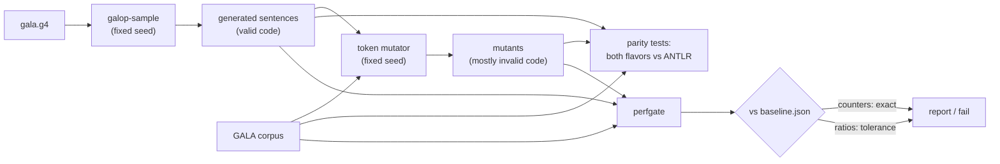

# Fuzzing and the performance gate

Two harnesses guard the generated parsers.

- **Fuzzing** checks that galop parses exactly like ANTLR on input no corpus holds.
- **The performance gate** checks that a change does not make galop slower or
  make it predict more at runtime.

Both run on `gala.g4` in the [differential harness](../differential/README.md).
The input generator works for any grammar galop accepts.



## Generated input: `galop-sample`

`galop-sample` (package [`sample`](../sample/sample.gala)) writes random sentences of a
grammar's parser rule.

**How it builds a sentence:**

1. It walks the grammar's parser ATN.
2. At each choice it takes an alternative that can still finish the rule. Half the
   time that is the alternative it has taken least often from that state, so rare
   alternatives come up too: a tuple pattern after `case`, a composite literal, a
   lambda. Otherwise it picks uniformly.
3. Once a rule is active more than `-nesting` times at once, or the sentence passes
   `-tokens` tokens, it takes the shortest way out. Every sentence ends.

**How it writes each token:** it walks that token's lexer rule and keeps a text only
if the grammar's own lexer reads it back as exactly that token. A token type with no
such text is never generated: for example, a `tokens {}` name that no lexer rule
produces, such as GALA's `NL_LPAREN`.

```sh
galop-sample [-n count] [-seed n] [-nesting n] [-tokens n] [-start rule] -o out grammar.g4
```

- **Deterministic.** The same grammar, flags and seed give the same file on every
  platform: the random source is SplitMix64, not Go's.
- **Output format.** Each sentence is written as its byte length on its own line,
  then the sentence and a newline.

The Bazel targets `//differential:samples`, `:samples_deep` and `:samples_large_1`
to `_4` generate fixed sets from `gala.g4`:

| Target | Sentences | Nesting | Max tokens | Used by |
|---|---:|---:|---:|---|
| `samples` | 600 | 2 | 300 | `generated_test`, `perfgate` |
| `samples_deep` | 200 | 4 | 800 | `generated_deep_test` |
| `samples_large_1` … `_4` | 4 × 1,000 | 3 | 600 | `generated_large_1_test` … `_4_test` (run on main) |

Keep `-nesting` at 4 or below for `gala.g4`. Lambdas and if-expressions nest without
brackets, and at six levels some 2 KB sentences take ANTLR's own prediction minutes,
against 0.1 s for galop. The oracle would time out, not galop.

## Parity tests

The tests are `//differential/diff:generated_test` and `:generated_deep_test`, run on
every PR, plus `:generated_large_1_test` to `_4_test`, run on pushes to main. The
large set is split in four because ANTLR's caches grow with every deep sentence, to
about 7 GB per test process. Each one runs three
checks on its sample set, for both flavors:

- **`TestGeneratedMatchesANTLR`** runs every generated sentence:
  - same verdict as ANTLR (the GALA compiler's SLL-then-LL strategy);
  - on accepted input, ANTLR's tree;
  - on rejected input, ANTLR's first syntax error: the same message at the same line
    and column.
  - A sentence with a lexical error fails the test: `galop-sample` writes only token
    texts the lexer reads back, so that is a generator bug. (`lexdiff` checks the
    lexers themselves.)
- **`TestMutations`** checks mutated copies of the generated sentences: a token
  dropped, doubled or preceded by stray text, or brackets changed. It checks the
  verdict and tree, and that a rejected file reports the same error as ANTLR's
  whole-input LL rerun.
- **`TestSyntaxErrors`** checks that rejected mutants report ANTLR's first error.

These are the same checks the corpus mutation tests run (`diff_test`, `heldout_test`
and the large runs), pointed at the generated input with `-samples` instead of
`-manifest`.

```sh
bazel test //differential/diff:generated_test //differential/diff:generated_deep_test
bazel test //differential/diff:generated_large_1_test   # one of the four large runs (manual)
```

## The performance gate: `perfgate`

`bazel run //differential/cmd/perfgate` measures three fixed inputs:

- **corpus:** every third file of the GALA corpus (241 files);
- **generated:** `//differential:samples`;
- **mutants:** 100 mutants of the corpus subset (seed 1).

### Counters

Counters are deterministic, so they are gated exactly. Each is measured on one
goroutine in a fresh process, so the process-wide caches start empty. They are taken
for both flavors.

| Counter | Meaning |
|---|---|
| `predictions` | runtime (adaptive) predictions, in every pass: the first, the repair or LL passes, and the replay that finds a rejected file's first error |
| `full-context` | full-context (LL) predictions |
| `replayed-files` | files that needed more than one pass (repair, rerun over tokens) |
| `replays-median`, `replays-max` | extra passes per such file |
| `sll-states`, `full-context-states` | states the prediction caches built: the warm-up |
| `allocs-per-pass` | allocations of a warm pass |
| `files`, `accepted` | the input's size and how much of it parses (reported, not judged: the parity tests check acceptance) |

The generated parser counts its own work in plain fields (`PFXStats`), which cost no
synchronization. The harness reads them through `nativegala.ParseWithStats` and
`antlrgala.ParseGalopWithStats`.

A counter above its baseline fails the gate. Allocations are the one exception: the
Go runtime's own background allocations move them by a few, so the baseline's
rules give them 1% (see [The baseline's rules](#the-baselines-rules)).

### Wall-clock times

Three operations are timed on 1 and on 32 goroutines:

- the native flavor;
- ANTLR, running the GALA compiler's strategy;
- the native lexer alone, which is the floor every parse pays.

Each is timed both warm and as the first pass in a fresh process.

Absolute times depend on the machine and are only reported, so the gate judges
ratios measured in the same job:

- **`…/galop-vs-antlr`:** galop's time over ANTLR's.
- **`…/galop-vs-lexer`:** galop's time over the lexer's warm time. The lexer's first
  pass is too short to time well. On 32 goroutines the baseline marks this ratio
  report-only: a lexer pass there takes well under a millisecond.

To keep the ratios stable on a shared runner:

- The three operations are timed in rounds, one sample of each per round. Each ratio
  is the median over rounds of that round's ratio, so a slow stretch slows both sides
  alike.
- Warm samples repeat a pass until it lasts 50 ms.
- A ratio fails only when it exceeds its baseline by more than its rule's tolerance
  (30%).

The gaps (first pass minus warm) are reported for galop and for the lexer. The
lexer's gap is the floor any Go program pays.

### CI

| Where | What | Judged |
|---|---|---|
| every PR and push: job `performance gate` | `perfgate` with the defaults above (a few minutes) | against `baseline.json`; enforcing only when `PERF_ENFORCE` is `"true"` in `ci.yml` |
| pushes to main and `workflow_dispatch`: job `mutation fuzz` | the large fuzz runs, then `perfgate -every=1 -mutants=300 -runs=7 -passes=7` | not judged: a wider report |

The gate writes its tables to the job summary and its numbers to the `perf` artifact
(`perf.json`).

### Running it locally

```sh
bazel run //differential/cmd/perfgate                    # report against the baseline
bazel run //differential/cmd/perfgate -- -times=false    # counters only (about 20 s)
bazel run //differential/cmd/perfgate -- -enforce        # exit 1 on a regression
```

On a busy machine the ratios are noisy, so judge ratios from CI runs. The counters
are the same everywhere.

### Updating the baseline

The baseline is [`differential/perf/baseline.json`](../differential/perf/baseline.json).
Update it when a change is meant to move the numbers, for example a change that
removes runtime predictions, and say so in the PR:

```sh
bazel run //differential/cmd/perfgate -- -update=differential/perf/baseline.json
```

- **Counters** come out the same on any machine.
- **Ratios** should come from the CI runner, because they depend on the machine.
  Download the `perf` artifact of a green run on the PR and copy its `ratios` into the
  baseline. `-update` keeps the baseline's rules.

### The baseline's rules

How each number is judged is policy, kept in the baseline file rather than in code.
`rules` is a list tried in order; the first whose `pattern` (a `path.Match` pattern,
`*` matching one `/`-separated part of the name) matches a number judges it:

```json
"rules": [
  {"pattern": "*/*/files", "tolerance": 0, "report_only": true},
  {"pattern": "*/*/accepted", "tolerance": 0, "report_only": true},
  {"pattern": "*/*/allocs-per-pass", "tolerance": 0.01},
  {"pattern": "*/w32/*/galop-vs-lexer", "tolerance": 0, "report_only": true},
  {"pattern": "*/*/*/*", "tolerance": 0.3}
]
```

- A number may exceed its baseline by `tolerance` (0.3 allows 30%) before it is
  `worse`.
- A `report_only` number is shown and never fails the gate.
- A number no rule matches has tolerance 0: counters (`flavor/input/name`, three
  parts) are judged exactly, and the last rule matches only ratios (four parts).

A verdict of `better` means a number fell below its baseline by more than its
tolerance. It doesn't fail the gate, but the baseline should be tightened to it so
the gain is kept.
