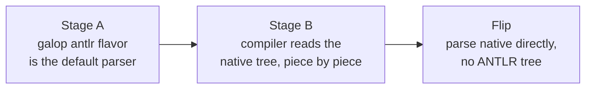
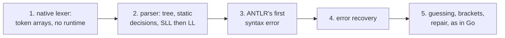

# galop roadmap

## Goal

A parser generator, written in GALA, that reads an ANTLR-style `.g4` grammar and emits
a recursive-descent parser whose every decision is made at generation time. Two tracks:

1. **Dogfood first.** Replace the ANTLR runtime parser in the
   [GALA compiler](https://github.com/martianoff/gala). The compiler's `gala.g4` stays
   its single source of truth, unchanged.
2. **A standalone tool, later.** Grow galop beyond what the GALA compiler needs, as a
   faster way to use existing `.g4` grammars.

## Why

ANTLR 4's runtime interprets a serialized ATN and builds its prediction DFA while it
parses, once per process, falling back to full-context LL prediction when SLL is not
enough. For a compiler that runs as a CLI, that warm-up dominates. Measured on the GALA
compiler (0.92.1, Go runtime):

| | ANTLR 4 | Hand-written recursive descent |
|---|---|---|
| `array.gala` (1,100 lines), warm | 7.4 ms, 68k allocations | 0.74 ms, 35 allocations |
| `array.gala`, fresh process | 88 ms | ~0.5 ms |
| `json/codec.gala` (needs LL fallback), warm | 150 ms | 0.37 ms |
| 723-file corpus, fresh process | 2.3 s | 30 ms |

Parsing is 30–60% of a single-file `gala transpile`. The hand-written parser behind the
right-hand column matched ANTLR on all 723 corpus files. It sets the bar for what
galop's generated code should look like and how fast it should run.

**Why we expect generated code to keep most of that gain.** The cold-start and
LL-fallback costs are work that generation-time decisions remove entirely, so they do
not depend on how polished the generated code is. The warm gain (~2–3× once ANTLR-shaped
tree nodes are built, about +1.5 ms on `array.gala`) does depend on codegen quality, which is why
M2 is a go/no-go spike. For reference, Go's own `go/parser`, a hand-written recursive
descent parser building a full AST, runs at ~60 MB/s versus ANTLR's ~5.4 MB/s on GALA.

## Design

**Input.** Standard `.g4` syntax, starting with the subset `gala.g4` uses. No grammar
annotations, so a grammar keeps working with ANTLR and its editor tooling.

**Analysis, at generation time.**
- FIRST/FOLLOW sets; each decision is classified as LL(1), LL(k ≤ 3), or adaptive.
- Adaptive decisions are settled ahead of time too. The first pass guesses each one
  from automata built at generation time (a go-on-or-stop loop goes on, a long shared
  prefix is scanned, the rest read a small automaton over the next tokens), and a
  pass that reaches EOF has built ANTLR's tree; a wrong guess is searched by replaying
  in ANTLR's order. Only then, and to report a syntax error, does ANTLR's own
  prediction run, over static ATN tables and the parser's real call stack, so every
  answer is ANTLR's. For `gala.g4`, the first pass never predicts at runtime. (An earlier plan
  used ordered-choice speculation; it cannot match ANTLR where the choice depends on
  the calling context, such as `case (a, b) =>`.) See [DESIGN.md](DESIGN.md).
- A **conflict report** names every adaptive decision. Its six known slow spots for
  `gala.g4` are:
  1. `(a, b) => …` lambda vs `(a, b)` tuple
  2. `Foo[T]{…}` composite literal vs `a[i]` index
  3. `case (a, b) =>` tuple pattern vs lambda (context)
  4. `if x {`: composite literal vs block (context)
  5. interface method result type vs the next method's name (newline)
  6. `if` statement vs `if` expression (alternative order)

  These are exactly the places where ANTLR is slow today, so the report doubles as a
  grammar lint.

**Output (Go first).** Plain recursive descent: a `switch` on the token kind, no
interpreter, no warm-up, no runtime dependency. Tree types expose ANTLR-compatible
accessors (`AllExpression()`, `GetStart()`, labels), so code written against ANTLR
contexts ports by changing imports.

**Lexer.** Generated (regex → DFA, longest match, rule priority).

**Errors.** A failed parse reports the same first syntax error as ANTLR parsing that
input in a fresh process, with the same message and position; the expected-token sets come out of the analysis. For an
editor, the native flavor also recovers as ANTLR's default error strategy does: every
error ANTLR reports, and ANTLR's error-recovered tree.

## Milestones

| # | Milestone | Done when | Status |
|---|---|---|---|
| M0 | Repo, CI, pinned GALA; `.g4` reader for `gala.g4`'s subset | `gala.g4` round-trips through the grammar model | **done** |
| M1 | Analysis and conflict report | The report names every decision static lookahead cannot settle, including the six above | **done**: gala.g4 has 107 decisions, 86 static (LL(1)–LL(3)) and 21 adaptive |
| M2 | Codegen spike | Within 2× of the hand-written parser, and at least 2× faster than ANTLR warm | **done**, and past the 10× goal: the native flavor parses the GALA corpus 11× faster than ANTLR warm (44 ms vs 466 ms) and 30× in a fresh process (49 ms vs 1.48 s); on code it was not tuned on, 97× and 114×. `array.gala` takes 0.73 ms warm, as fast as the hand-written parser measured earlier on the same machine (0.74 ms). The antlr flavor is 2.9× and 8.5× on the corpus. See the [README](../README.md) for the full table |
| M3 | Codegen: all of `gala.g4`, recognizer and tree | Every corpus file gives a tree identical to ANTLR's | **done**: 722/722 (ANTLR rejects the 723rd), checked in CI by the Bazel differential test |
| B1 | Bazel: a `galop_parser` rule in rules_gala, using galop's release binaries | A Bazel build generates the same files as the CLI, with no GALA toolchain needed to run galop | **done**: rules_gala 0.5.0 with galop 0.1.0; now rules_gala 0.6.12 with galop 0.3.2 (both flavors, the converter, and native error recovery) |
| M4 | Used by the GALA compiler behind an ANTLR fallback, built with B1 | GALA's test suite green; parse share of a CLI transpile under 5% | **done**: stage A shipped in GALA 0.94.0; stage B and the flip ship in GALA 0.100.0. The parse is under 1% of a CLI transpile (see [M4 in GALA](#m4-in-gala)) |
| M5 | Expression entry points on the generated parser | No ANTLR call on the success path | **done**: defaults and string interpolation parse with the native expression parser (GALA #957, #969, #987) |
| M6 | Generated error recovery | Editor diagnostics match ANTLR on a broken-input corpus | **done** (galop 0.3.0–0.3.2; GALA martianoff/gala#1059). `Parse<Rule>WithRecovery` (native flavor) reports every error ANTLR reports, in order, and builds ANTLR's error-recovered tree, on every one of 19,000 broken GALA files (mutants and editor-style edits of both corpora and of generated sentences) and 18,000 mutants of six test grammars; the first error alone matches on 60,000+. GALA now takes its syntax errors, their hints and the editor's recovered tree from galop: its own differential test matches ANTLR on 6,432 of 6,432 broken files. On a broken 1,200-line file, a parse went from 225–260 ms to 3.5–22 ms and from about 260 MB to 3.5–15.5 MB, and an editor keystroke from 274–325 ms to 31–50 ms. See [DESIGN.md](DESIGN.md#recovering-from-syntax-errors-as-antlr-does) |
| M7 | ANTLR removed from GALA | GALA builds with no ANTLR runtime or generated ANTLR parser: syntax errors, their hints and editor recovery come from galop (done in M6); the `--parser antlr` engine, the ANTLR-to-native converter, the fallback that re-reads input with ANTLR when galop's lexer or parser panics, and the `antlr` flavor build are deleted; the ANTLR Go runtime leaves `go.mod` and `MODULE.bazel`. The IntelliJ plugin's ANTLR-generated Java parser is a separate decision | **done** (GALA martianoff/gala#1131). The `gala` binary is 1.86 MB (7.6%) smaller, `go.mod` lost the ANTLR runtime and `golang.org/x/exp`, and a galop panic is now reported as an internal-compiler-error diagnostic on that file instead of falling back to ANTLR. GALA keeps galop's parity in a golden test over its corpus and edge cases; the ANTLR comparisons run in galop's CI. The IntelliJ plugin still generates its Java parser from gala.g4 |
| T2 | Standalone track begins | M4 shipped; differential harness over grammars-v4 running | |

## M4 in GALA

GALA adopts galop in two stages. ANTLR stays selectable throughout
(`gala --parser antlr`, or `GALA_PARSER=antlr`) and keeps its own CI lane.

**Stage A: done (GALA 0.94.0).**
- galop's `antlr` flavor is GALA's default parser. On a syntax error GALA falls back to ANTLR.
- galop is required to build GALA.
- Generated Go is byte-identical on 7,280 files.
- On a real project, GALA→Go transpiling is 48% faster, `gala build` 31% faster and `gala test` 23% faster. Peak memory is about 45% lower.

**Stage B: done (GALA 0.100.0).**
- GALA's tree consumers move from ANTLR's contexts to the native tree. While both trees exist, galop's converter (`<G>ToNativeContexts`, galop 0.2.5) builds the native tree from ANTLR's.
- Each step keeps generated Go byte-identical, under both parsers, and is checked by a test that compares the two trees.

| Step | Scope | Status |
|---|---|---|
| Plumbing, parser utilities, scope walk | lazy native tree, type text, scope walk | done (gala #904, #905, #906) |
| Analyzer | top-level collection | done (gala #910) |
| | package-level value inference | done (gala #916) |
| | undefined-symbol check | done (gala #923) |
| | the rest | done (gala #932) |
| Transformer | top-level walk and declarations | done (gala #922) |
| | statements and blocks | done (gala #933) |
| | types, sealed and opaque declarations | done (gala #943) |
| | lambdas | done (gala #942) |
| | expressions (operators, literals, names, if-expressions) | done (gala #944) |
| | match and patterns | done (gala #945) |
| | member access and indexing | done (gala #949) |
| | calls | done (gala #954) |
| | argument values and expected-type checks | done (gala #955) |
| LSP and tools | signature help, hover, `gala imports`, `gala doc`, capture analysis | done (gala #934, #935) |
| Removing ANTLR from the transformer | partial functions, composite literals, tail calls | done (gala #959) |
| | statements, bind chains, if-expression branches | done (gala #960) |
| | match and patterns | done (gala #967) |
| | declarations, error paths, keyed state | done (gala #963) |
| | cut-over plumbing: native tree for every clean parse, siblings, imports and editor buffers | done (gala #968) |
| | defaults and string interpolation | done (gala #969) |
| | transformer reads only the native tree; ANTLR twins deleted | done (gala #977) |
| | analyzer and scope walk read only the native tree | done (gala #984) |
| | LSP reads only the native tree | done (gala #986) |
| The flip (prep) | native token handling, doc comments, expression parse | done (gala #957) |
| The flip | GALA parses with the native parser by default; no ANTLR tree on a clean parse | done (gala #987) |

**The flip: done (GALA 0.100.0).**
- GALA parses with galop's native parser and builds no ANTLR tree for a clean file.
- ANTLR is still used for three things: to re-parse a file with a syntax error (so error messages stay the same), for editor error recovery, and when `--parser antlr` is selected (ANTLR parse, then galop's converter).
- Generated Go is byte-identical to the previous release, under both parsers.

Measured on gala-tui, all versions in one alternating run on a quiet machine (medians):

| | GALA 0.93.2 (ANTLR) | GALA 0.95.0 (stage A) | GALA 0.100.0 (flip) |
|---|---:|---:|---:|
| `gala build` | 10.0 s | 7.43 s | 6.03 s |
| GALA→Go transpile | 7.91 s | 5.33 s | 3.65 s |
| parsing (all files) | 491 ms | 114 ms | 32 ms |
| `gala build` peak memory | 859 MB | 484 MB | 178 MB |
| `gala test` | 15.4 s | 12.3 s | 9.14 s |
| `gala test` peak memory | 880 MB | 527 MB | 180 MB |
| `gala imports --json`, 737 files | 1.70 s | 349 ms | 182 ms |
| editor keystroke, file with a syntax error | 655 ms | 313 ms | 166 ms |
| build worker memory kept | 510 MB | 406 MB | 112 MB |

Parsing is now under 1% of a build; the rest is Go type loading, analysis, transformation and the Go compiler. Since M7, GALA has no ANTLR at all.

## Beyond ANTLR (track 2)

Roughly by payoff, and not before M4 ships:

- **A drop-in for existing `.g4` grammars in Go.** The public
  [grammars-v4](https://github.com/antlr/grammars-v4) collection is both the test corpus
  (differential against ANTLR) and the adoption path.
  Directly left-recursive rules, which most expression grammars use (Milvus's filter
  expressions, CEL, SigNoz, Grule), are generated and checked against ANTLR; see
  [DESIGN.md](DESIGN.md#left-recursive-rules).
- **The conflict report as a feature.** ANTLR hides ambiguity until it is slow in
  production; galop names it at build time, including the decisions where valid input
  sends ANTLR to full-context prediction and the grammar change that avoids it.
- **GALA as an output target**, for DSL parsers written in GALA.
- **Editor tooling from the same grammar**: highlighting, outline, an LSP skeleton.
- **Incremental reparsing** for editors.

### More target languages

Go is galop's complete target today; Python has a lexer. Projects that use ANTLR often generate one grammar
into several languages, and a project whose parsers are not all in languages galop
supports cannot adopt it: a second generator for some languages is extra work, not a
gain. More targets therefore come next, in the order ANTLR users most need them:

| Target | Why | Checked against |
|---|---|---|
| Go | done | ANTLR's Go runtime |
| Python | lexers done (both flavors); native parser next (below). The largest gain: on gofileseq's grammar ANTLR's Python runtime takes 6.5 ms for a frame range its Go runtime parses in 0.39 ms | ANTLR's Python runtime |
| Java | ANTLR's reference target, the most used | ANTLR's Java runtime |
| TypeScript / JavaScript | parsers in browsers and editors | ANTLR's TypeScript runtime |
| C++ | native tools that share a grammar with Python or Java | ANTLR's C++ runtime |
| C# | .NET projects | ANTLR's C# runtime |

Each target is a `codegen.Target`, as Go is. It gets both flavors where the language
allows (the `antlr` flavor builds that runtime's own contexts; the native flavor needs
no runtime), the same differential harness against ANTLR's runtime for that language,
and a performance gate. A grammar then means the same thing in every target galop
supports, as it does in ANTLR.

#### The Python parser

The Python parser is native, as the Go target's default flavor is: galop's own
tokens and tree and no ANTLR runtime. Speeding up ANTLR's Python parser piece by
piece would gain little: profiled on GALA sources, its time is spread over
error-recovery sync (about 30%), prediction (21%), the token stream (20%) and
entering and leaving rules (11%). It comes in steps, each checked against ANTLR's
Python runtime by `//differential/python`:

1. **Native lexer** (`-Dflavor=native`, done): the token list as parallel arrays, the
   off-channel tokens and token recognition errors, as the Go native lexer has them.
2. **Parser** (done): the native tree, rule functions with the decisions the analysis
   settles statically, and ANTLR's prediction (SLL, then LL from the start on a
   failure) over tables in the generated file for the rest. Valid input gives
   ANTLR's tree.
3. **First syntax error** (done): ANTLR's message, line and column for invalid input.
4. **Error recovery** (done): ANTLR's recovered tree and every error it reports.
5. **The Go target's prediction speedups** (guessing first pass, bracket
   abstraction, repair, the full-context cache), each where it pays in Python.

Grammar features ANTLR users rely on and galop does not read yet (lexer modes, embedded
actions in the target language, `tokenVocab`) matter as much as the languages: a
project needs all of its grammar supported too.

**Adoption.** galop is offered only to projects whose parsers are all in languages it
supports, and whose grammars use only what it supports. Its speed is compared with
ANTLR on the same grammar after the cheap fixes: a grammar that sends valid input to
ANTLR's full-context fallback (one shared rule called from contexts SLL cannot tell
apart) is often fixed in the grammar itself, and that fixed ANTLR is the baseline.

## Risks

- **GALA compiler bugs hit while dogfooding.** They get a repro and a fix upstream, not a
  workaround. That is part of the point, but it slows galop down.
- **Ordered-choice speculation vs ANTLR's full-context prediction** can disagree on
  unusual input. Differential testing (corpus plus mutation fuzzing against ANTLR)
  catches it; any accepted divergence is documented.
- **Error recovery** past what the differential corpora exercise could still differ from
  ANTLR's; the large fuzz runs keep looking.
- **Scope creep from track 2.** It waits for M4.
