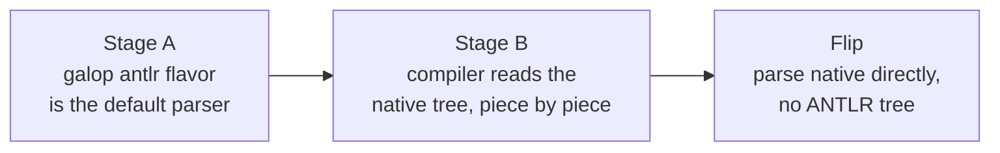

# galop roadmap

## Goal

A parser generator, written in GALA, that reads an ANTLR-style `.g4` grammar and emits
a recursive-descent parser whose every decision is made at generation time. Two tracks:

1. **Dogfood first.** Replace the ANTLR runtime parser in the
   [GALA compiler](https://github.com/martianoff/gala). The compiler's `gala.g4` stays
   its single source of truth, unchanged.
2. **A standalone tool, later.** Grow galop beyond what the GALA compiler needs, as a
   faster way to use existing `.g4` grammars.

## Why

ANTLR 4's runtime interprets a serialized ATN and builds its prediction DFA while it
parses, once per process, falling back to full-context LL prediction when SLL is not
enough. For a compiler that runs as a CLI, that warm-up dominates. Measured on the GALA
compiler (0.92.1, Go runtime):

| | ANTLR 4 | Hand-written recursive descent |
|---|---|---|
| `array.gala` (1,100 lines), warm | 7.4 ms, 68k allocations | 0.74 ms, 35 allocations |
| `array.gala`, fresh process | 88 ms | ~0.5 ms |
| `json/codec.gala` (needs LL fallback), warm | 150 ms | 0.37 ms |
| 723-file corpus, fresh process | 2.3 s | 30 ms |

Parsing is 30–60% of a single-file `gala transpile`. The hand-written parser behind the
right-hand column matched ANTLR on all 723 corpus files. It sets the bar for what
galop's generated code should look like and how fast it should run.

**Why we expect generated code to keep most of that gain.** The cold-start and
LL-fallback costs are work that generation-time decisions remove entirely, so they do
not depend on how polished the generated code is. The warm gain (~2–3× once ANTLR-shaped
tree nodes are built, about +1.5 ms on `array.gala`) does depend on codegen quality, which is why
M2 is a go/no-go spike. For reference, Go's own `go/parser`, a hand-written recursive
descent parser building a full AST, runs at ~60 MB/s versus ANTLR's ~5.4 MB/s on GALA.

## Design

**Input.** Standard `.g4` syntax, starting with the subset `gala.g4` uses. No grammar
annotations, so a grammar keeps working with ANTLR and its editor tooling.

**Analysis, at generation time.**
- FIRST/FOLLOW sets; each decision is classified as LL(1), LL(k ≤ 3), or adaptive.
- Adaptive decisions are settled ahead of time too. The first pass guesses each one
  from automata built at generation time (a go-on-or-stop loop goes on, a long shared
  prefix is scanned, the rest read a small automaton over the next tokens), and a
  pass that reaches EOF has built ANTLR's tree; a wrong guess is searched by replaying
  in ANTLR's order. Only then, and to report a syntax error, does ANTLR's own
  prediction run, over static ATN tables and the parser's real call stack, so every
  answer is ANTLR's. For `gala.g4`, the first pass never predicts at runtime. (An earlier plan
  used ordered-choice speculation; it cannot match ANTLR where the choice depends on
  the calling context, such as `case (a, b) =>`.) See [DESIGN.md](DESIGN.md).
- A **conflict report** names every adaptive decision. Its six known slow spots for
  `gala.g4` are:
  1. `(a, b) => …` lambda vs `(a, b)` tuple
  2. `Foo[T]{…}` composite literal vs `a[i]` index
  3. `case (a, b) =>` tuple pattern vs lambda (context)
  4. `if x {`: composite literal vs block (context)
  5. interface method result type vs the next method's name (newline)
  6. `if` statement vs `if` expression (alternative order)

  These are exactly the places where ANTLR is slow today, so the report doubles as a
  grammar lint.

**Output (Go first).** Plain recursive descent: a `switch` on the token kind, no
interpreter, no warm-up, no runtime dependency. Tree types expose ANTLR-compatible
accessors (`AllExpression()`, `GetStart()`, labels), so code written against ANTLR
contexts ports by changing imports.

**Lexer.** Generated (regex → DFA, longest match, rule priority).

**Errors.** A failed parse reports the same first syntax error as ANTLR parsing that
input in a fresh process, with the same message and position; the expected-token sets come out of the analysis. Until generated
error recovery is good enough for editor use, a consumer that needs every error can fall
back to ANTLR on a syntax error.

## Milestones

| # | Milestone | Done when | Status |
|---|---|---|---|
| M0 | Repo, CI, pinned GALA; `.g4` reader for `gala.g4`'s subset | `gala.g4` round-trips through the grammar model | **done** |
| M1 | Analysis and conflict report | The report names every decision static lookahead cannot settle, including the six above | **done**: gala.g4 has 107 decisions, 86 static (LL(1)–LL(3)) and 21 adaptive |
| M2 | Codegen spike | Within 2× of the hand-written parser, and at least 2× faster than ANTLR warm | **done**, and past the 10× goal: the native flavor parses the GALA corpus 11× faster than ANTLR warm (44 ms vs 466 ms) and 30× in a fresh process (49 ms vs 1.48 s); on code it was not tuned on, 97× and 114×. `array.gala` takes 0.73 ms warm, as fast as the hand-written parser measured earlier on the same machine (0.74 ms). The antlr flavor is 2.9× and 8.5× on the corpus. See the [README](../README.md) for the full table |
| M3 | Codegen: all of `gala.g4`, recognizer and tree | Every corpus file gives a tree identical to ANTLR's | **done**: 722/722 (ANTLR rejects the 723rd), checked in CI by the Bazel differential test |
| B1 | Bazel: a `galop_parser` rule in rules_gala, using galop's release binaries | A Bazel build generates the same files as the CLI, with no GALA toolchain needed to run galop | **done**: rules_gala 0.5.0 with galop 0.1.0; now rules_gala 0.6.5 with galop 0.2.5 (both flavors, plus the converter) |
| M4 | Used by the GALA compiler behind an ANTLR fallback, built with B1 | GALA's test suite green; parse share of a CLI transpile under 5% | **stage A shipped** in GALA 0.94.0; **stage B in progress** (see [M4 in GALA](#m4-in-gala)) |
| M5 | Expression entry points on the generated parser | No ANTLR call on the success path | |
| M6 | Generated error recovery | Editor diagnostics match ANTLR on a broken-input corpus | first error done: it matches ANTLR on 60,000+ broken files of both corpora; recovery past it remains |
| T2 | Standalone track begins | M4 shipped; differential harness over grammars-v4 running | |

## M4 in GALA

GALA adopts galop in two stages. ANTLR stays selectable throughout
(`gala --parser antlr`, or `GALA_PARSER=antlr`) and keeps its own CI lane.

**Stage A: done (GALA 0.94.0).**
- galop's `antlr` flavor is GALA's default parser. On a syntax error GALA falls back to ANTLR.
- galop is required to build GALA.
- Generated Go is byte-identical on 7,280 files.
- On a real project, GALA→Go transpiling is 48% faster, `gala build` 31% faster and `gala test` 23% faster. Peak memory is about 45% lower.

**Stage B: in progress.**
- GALA's tree consumers move from ANTLR's contexts to the native tree. While both trees exist, galop's converter (`<G>ToNativeContexts`, galop 0.2.5) builds the native tree from ANTLR's.
- Each step keeps generated Go byte-identical, under both parsers, and is checked by a test that compares the two trees.

| Step | Scope | Status |
|---|---|---|
| Plumbing, parser utilities, scope walk | lazy native tree, type text, scope walk | done (gala #904, #905, #906) |
| Analyzer | top-level collection | done (gala #910) |
| | package-level value inference | done (gala #916) |
| | undefined-symbol check | done (gala #923) |
| | the rest | in progress |
| Transformer | top-level walk and declarations | in review (gala #922) |
| | statements, expressions, calls, lambdas, patterns, types | next |
| LSP and tools | | not started |

**The flip** comes after stage B. GALA then parses natively without building ANTLR's tree, and `--parser antlr` keeps working through the converter. It ships only if it beats stage A on build time, test time and editor latency.

## Beyond ANTLR (track 2)

Roughly by payoff, and not before M4 ships:

- **A drop-in for existing `.g4` grammars in Go.** The public
  [grammars-v4](https://github.com/antlr/grammars-v4) collection is both the test corpus
  (differential against ANTLR) and the adoption path.
- **The conflict report as a feature.** ANTLR hides ambiguity until it is slow in
  production; galop names it at build time.
- **GALA as an output target**, for DSL parsers written in GALA.
- **Editor tooling from the same grammar**: highlighting, outline, an LSP skeleton.
- **Incremental reparsing** for editors.
- **More output targets** (TypeScript, Rust), only if there is demand.

## Risks

- **GALA compiler bugs hit while dogfooding.** They get a repro and a fix upstream, not a
  workaround. That is part of the point, but it slows galop down.
- **Ordered-choice speculation vs ANTLR's full-context prediction** can disagree on
  unusual input. Differential testing (corpus plus mutation fuzzing against ANTLR)
  catches it; any accepted divergence is documented.
- **Error recovery** is the long tail; the ANTLR fallback keeps it off the critical path
  until M6.
- **Scope creep from track 2.** It waits for M4.
